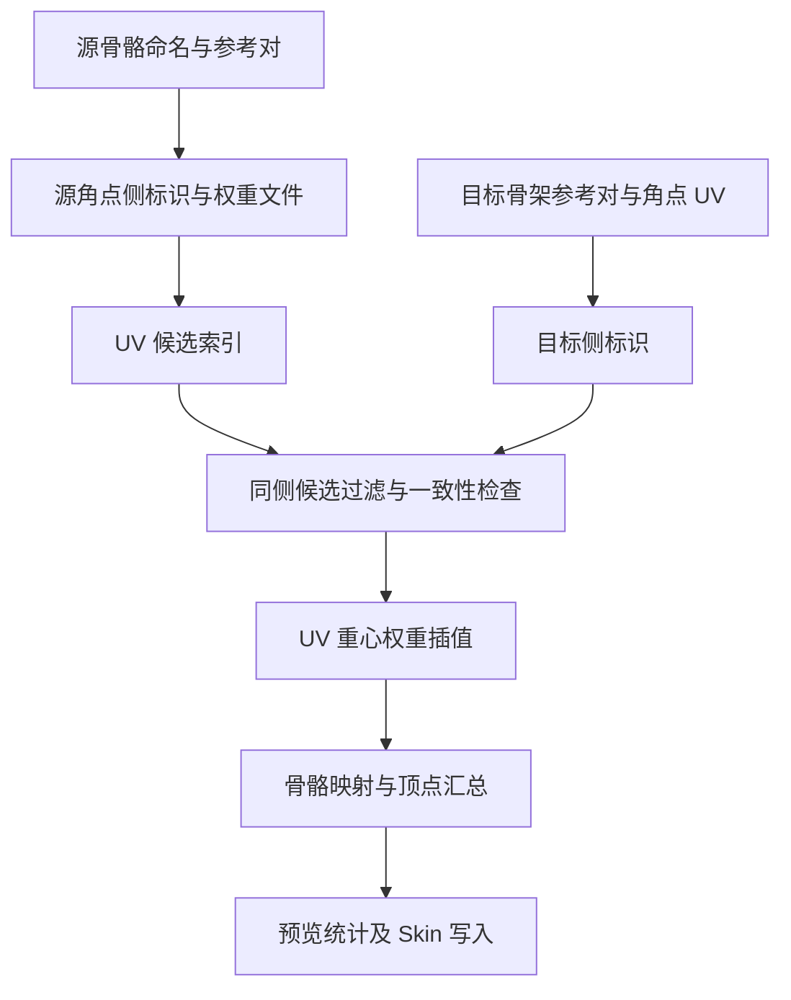

# UV 空间蒙皮权重复制开发计划

更新日期：2026-10-29
状态：P1–P5 功能已落地并完成离线回归；真实 3ds Max 宿主与资产验收待完成。
适用程序：[DIYFaceSkinUVTransfer.py](file:///g:/Git_NDTools/JTMY/DIYFace/DIYFaceSkinUVTransfer.py)
算法模块：[DIYFaceSkinUVSemantics.py](file:///g:/Git_NDTools/JTMY/DIYFace/DIYFaceSkinUVSemantics.py)

## 执行记录（2026-10-29）

- P1：已实现左右命名解析、明确规则、本名配对、唯一骨骼映射和重名/冲突报告；目标未加入 Skin 时也可按全场景唯一语义匹配，禁止自动跨侧。
- P2：UV 导出升级为 v3，保存真实采集的参考位置、侧标量、区域、规则版本及材质 ID；新读取器严格验证 v2/v3。无参考时使用 null/Unknown，不伪造中线。
- P3：已取消首候选策略；按唯一角点采样进行同侧、中线及完整权重一致性检查。保留缺失骨骼身份参与消歧，必要采样任一失败则保留顶点。修复 UV 索引邻格查询遗漏。
- P4：已接入参考对、左右镜像标识、容差、只读预览与详细报告。正式 Skin 创建、必要骨骼补充、boneLimit 和权重写入置于单次 Undo 内，虚拟骨骼 ID 重映射为实际 ID。
- 界面简化：参考 Joe Anim Picker 的镜像拾取，移除名称规则/骨骼映射 JSON 输入，改为左、右标识两个文本框，默认 `_L_` / `_R_`，区分大小写按字面替换。导出设源标识，导入设目标标识；源规则仍存于 v3 文件，自动完成同本名同侧唯一映射。参考对由复选框启用，自动选择距网格最近且左右分离的一对镜像骨骼；解析预览仅作诊断，不参与选择。两个标识均留空使用原自动解析；单空、相同、互相包含及左右同时命中会明确拒绝。标识不是跨侧权重交换规则。底层显式映射 API 保留，不再要求日常用户填写 JSON。
- 姿态处理：已按用户要求移除姿态说明与使用前确认。默认模型处于绑定姿势，工具直接采集当前网格与参考骨骼位置，不读取绑定矩阵、不切换姿势；姿态不正确时不自动检测，需用户自行保证。
- P5：已实现默认关闭的材质备选；离线覆盖 v2、兼容格式、独立距离模式、覆盖/未加权/混合以及模拟失败撤销。中间验证脚本、编译缓存均放在系统临时目录。

### 当前实现边界与待验收项

- 参考位置直接采集当前（默认绑定姿势）的网格与骨骼位置，不读取或宣称 Skin 绑定矩阵；源参考对必须属于源 Skin 骨骼表，目标参考对可尚未加入 Skin。
- 中线带宽暂定 `0.001`，候选容差默认 `1e-5`，界面不再暴露，由内部默认值决定，尚待真实面部资产校准。
- v2 无完整源侧数据时仅按 UV 候选一致性导入，并提示重导 v3；未实现给 v2 临时补源参考数据的界面。
- 本期不启用可信目标旧权重辅助侧校验或源侧权重贡献诊断；目标旧权重仅用于既有混合/未加权写入语义。
- Python 3 离线测试及 Python 2 语法兼容检查已通过；真实 Python 2.7、Qt/PySide 界面、SkinOps 只读查询、采样姿态一致性和真实 Undo 回滚仍需在 3ds Max 验收。模拟接口通过不等同于宿主验收通过。
- 下文为设计与验收基线，原“当前行为”及旧行号代表实施前状态；以实际源码为准。

## 1 目标与设计边界

### 已确认需求

- 源与目标使用相同 UV 布局，顶点数、点序和拓扑可以不同。
- 通过“导出权重文件 → 目标加载导入”复制，源模型不必留在目标场景。
- 左右点面可能共用 UV，需要避免左右骨骼权重串侧。
- 主要辅助信息来自骨骼：名称中的 Left/Right、`_L_`、`_R_` 等标识，以及骨骼参考位置。
- 材质 ID 通常不可用，只保留为备选分区依据。
- 不用目标点到源三角面的三维距离选择候选，不插值三维对应点。

### 方案决策

骨骼左右名称用于识别骨骼对，骨骼对的位置用于建立各模型自己的左右参考平面。模型点相对于该平面的符号用于区分 Left/Right 区域。区域内仍完全按 UV 查询及插值权重。

骨骼名称本身只能说明骨骼的左右属性，不能直接说明一个未加权目标顶点属于哪侧。主方案需要读取目标顶点相对于目标骨架的方向，但不会比较源目标点的位置或距离。

**若连目标点相对于骨架的位置也不能使用，且目标没有可信权重或其他区域标签，仅凭骨骼名称无法唯一消除重叠 UV 歧义。**

### 待验证假设

- 源、目标骨架具有可识别且位置分离的对应左右骨骼对。
- 网格与各自骨架在参考姿态中对齐；任意变形姿态不作为首期支持条件。
- 骨骼对形成的左右参考平面能区分待处理部位。面部优先选择眼部或脸部对应骨骼对，不默认用全身所有骨骼位置平均。
- 不同命名风格主要体现在左右标识；部位本名不同仍需用户指定骨骼映射。

同侧多层重叠、重复配件、上下嘴唇共用 UV 等情况，Left/Right 信息可能不足，不能宣称自动解决。

## 2 当前实现与改动范围

现有程序已经支持 JSON UV v2、兼容格式、UV 三角面索引、UV 重心权重插值、按名称映射骨骼、距离复制、三种写入模式、影响数限制和 Undo。

需要调整的位置：

| 位置 | 当前行为 | 计划改动 |
| --- | --- | --- |
| [`_collect`](file:///g:/Git_NDTools/JTMY/DIYFace/DIYFaceSkinUVTransfer.py#L160-L190) | 保存点位置、权重、面 UV、骨骼名 | 增加骨骼语义、参考骨骼对及分区数据 |
| [`_bone_key`](file:///g:/Git_NDTools/JTMY/DIYFace/DIYFaceSkinUVTransfer.py#L281-L296) | 短名与 FBXASC 规范化后匹配 | 将名称清理、左右解析、身份映射分开；增加重名冲突报告 |
| [`_query_uv`](file:///g:/Git_NDTools/JTMY/DIYFace/DIYFaceSkinUVTransfer.py#L363-L381) | 返回全部 UV 候选 | 保留查询；候选携带区域信息 |
| [`_interpolate_weights`](file:///g:/Git_NDTools/JTMY/DIYFace/DIYFaceSkinUVTransfer.py#L436-L442) | UV 重心系数插值权重 | 保留核心算法 |
| [`import_weights` 的 UV 分支](file:///g:/Git_NDTools/JTMY/DIYFace/DIYFaceSkinUVTransfer.py#L529-L564) | 去重顶点 UV 后取 `candidates[0]` | 按角点保留区域上下文，过滤及验证候选，不再默认取首面 |
| [`SkinUVTransferDialog`](file:///g:/Git_NDTools/JTMY/DIYFace/DIYFaceSkinUVTransfer.py#L649-L674) | 现有导入导出 UI | 增加左右规则、参考骨骼对、预览与歧义统计 |

此次计划不重写距离复制和兼容格式功能。距离复制保持独立选项，不作为 UV 消歧的隐式回退。旧计划中的三维最近距离消歧、最近骨骼自动兜底和无依据平均候选策略取消。

## 3 骨骼命名与左右参考

### 3.1 左右标识解析

先解码 FBXASC，再处理层级与名称空间，最后识别左右语义。大小写不敏感，但原始名称保留用于展示及精确查找。

| 支持规则 | 示例 | 解析结果 |
| --- | --- | --- |
| 分隔符包围的单字母 | `FACIAL_L_Eye`、`FACIAL_R_Eye` | Left/Right，本名 `facial_{side}_eye` |
| 前缀或后缀单字母 | `L_Eye`、`Eye_R`、`Eye.L`、`Eye-R` | Left/Right，本名保留侧标记所在位置 |
| 完整单词 | `Left_Eye`、`Eye_Right` | Left/Right |
| 明确驼峰词边界 | `LeftEye`、`EyeRight` | Left/Right；在转小写前检测边界 |
| 无侧标识 | `Head`、`Jaw`、`Root` | Unspecified，不等同于空间上的中线 |
| 名称包含冲突标识 | `L_Eye_R` | Conflict，禁止自动配对 |

不通过任意子串 `l`/`r` 识别，避免把 `Upper`、`Lower`、`Roll`、`Clavicle` 误认为左右。`Leftover` 等完整单词也不因为前缀含 Left 就自动分类。连接式全小写名称及其他缩写通过用户规则处理。

规则按“用户明确映射 → 明确完整词/词边界 → 有边界单字母”解析；重叠命中且结果一致可合并，冲突必须报告。

### 3.2 左右骨骼配对与身份映射

同骨架内按“移除侧标识后的规范化本名”配对左右骨骼；出现多个 Left 或 Right 同名候选时禁止静默取第一个。

源到目标的权重映射独立处理：

1. 用户明确指定的源目标映射。
2. 原始名称或规范化名称唯一匹配。
3. 本名相同且 side 相同的唯一语义匹配，例如 `FACIAL_L_Eye` 对应 `FACIAL_Left_Eye`。
4. 仍缺失或冲突则报告，不能按最近骨骼位置替代。

Left 源骨骼不自动映射到 Right 目标骨骼。未命名骨骼不自动视为“中央骨骼”。不同本名如 `Eye_L` 与 `LeftEye` 可形成建议，但首期要求明确别名/映射，不擅自删除所有分隔符来猜测。

### 3.3 骨骼对生成左右参考平面

源和目标各自选一对对应部位骨骼。名称确定语义 Left/Right，不假设世界 X 正方向是左侧。

设左右骨骼参考位置为 `pL` 和 `pR`：

```text
c = (pL + pR) / 2
n = normalize(pL - pR)
d = dot(p - c, n) / length(pL - pR)

d > epsilonSide   → Left
d < -epsilonSide  → Right
其他              → CenterBand
```

`epsilonSide` 是无量纲中线带宽，默认值在资产验证后确定。除以骨骼间距使阈值不依赖模型单位和统一缩放。

源与目标分别计算平面，允许两套模型与各自骨架一起平移、旋转和统一缩放；不要求两模型彼此世界对齐。网格独自移动而骨架不动、任意非均匀缩放、错误参考姿态和退化骨骼对都需报告或重新配置，不保证自动适应。

参考对由复选框启用，自动选择距网格最近且左右分离的一对镜像骨骼；解析预览仅作诊断，不参与选择。不自动汇总所有面部骨骼来猜方向。双眼对、脸部对或其他局部对可选，只要适合目标部位。

首期优先在用户指定参考姿态采集网格点和骨骼位置。读取 Skin 绑定参考变换的具体 pymxs/MaxScript 接口及其和网格采样的一致性尚需验证，未验证前不能将当前节点变换宣称为绑定矩阵。

### 3.4 已有权重的使用边界

源模型拥有可信权重，可统计命名为 Left/Right 的权重贡献作为诊断信息。中央或未命名骨骼的权重不参与侧贡献统计。真实蒙皮可能含跨侧影响，不能据此删除对侧权重。

目标现有权重默认不作为分类依据，因为可能为空、全挂 Head，或本身就是待修复错误权重。仅在用户明确声明可信时，作为辅助校验；与骨骼平面冲突则报告，不自动覆盖分类。

## 4 UV 候选消歧与权重汇总

### 数据流



图 1：骨架提供侧标识，UV 提供对应关系。源骨架信息在导出时采集，目标只依赖文件和自身骨架；汇总完成后才进入写入流程。

### 4.1 源与目标分区

源三角面保存三个角点的左右有符号值 `d`，同侧面可缓存区域标签。跨中线面不能简单按面中心强制归到一侧。

查询目标 UV 时，对每个源候选，用该候选的 UV 重心系数插值已保存的标量 `d`，取得候选采样点的 Left/Right/CenterBand 标签。此步骤只插值侧分类标量和权重，不构造三维对应点，也不计算源目标距离。它使跨中线源面可在不同 UV 位置产生不同侧标签。

目标按面角点记录 UV、顶点编号和目标侧标识。唯一采样键至少包含 `(UV, side)`；若用户启用材质备选，还包含材质区域。重复关联面不应增加同一采样的权重，避免目标面密度改变结果。

### 4.2 候选选择规则

- 目标 Left/Right：只接受同侧候选；不在没有同侧候选时偷偷采用对侧面。
- 目标 CenterBand：优先 CenterBand 候选；没有中线候选时，仅允许权重一致的其他候选进入结果，否则记为歧义。
- 未能建立有效参考平面：仍可计算全部 UV 候选；若候选权重一致则接受，否则保留目标原权重。
- 多个同侧候选：先完成骨骼身份映射，再比较完整、归一化且未截断影响数的权重向量。差异低于容差则可视为等价；不一致则记为歧义，不按面顺序选择、不无条件平均。
- 比较容差暂定沿用 `1e-5` 量级，实际边界稳定性需验证。影响数截断在消歧完成后处理，避免截断掩盖候选差异。
- 退化 UV 三角面跳过；UV 未覆盖单独报告。

对于完全不重叠的普通 UV，即使没有有效左右参考，唯一有效候选也可以导入；不得因此使整个工具强制依赖左右骨骼。

### 4.3 插值与写入

通过 UV 重心系数插值源顶点完整权重，保留源原有合法跨侧影响，不因分区删除 Right 或 Left 骨骼贡献。

目标顶点具有多个唯一角点采样时，仅对无歧义采样求等权平均，再限制影响数并归一化。首期采用严格策略：任一必要采样未覆盖、冲突或歧义，该顶点不写入，保留旧权重并记录原因，避免少量成功采样掩盖接缝错误。

源骨骼缺失时记录影响及损失权重；默认保留已有映射行为，但预览明确展示损失。歧义比较不能将不同的缺失影响都删去后误判为相同候选。

左右标识只决定源区域选择，不决定最终权重中允许哪些骨骼。`flip_u` 仍仅翻转 U，不交换骨骼 Left/Right；跨侧镜像复制属于后续独立功能。

## 5 文件与界面设计

### 5.1 拟议 UV v3 数据

现有 v2 字段继续保留，新增与骨骼及侧分类有关的数据。版本升级为 v3，旧脚本会拒绝该版本，新读取器明确支持 v2/v3，避免旧版本忽略分区后错误导入。

| 字段 | 约束与用途 |
| --- | --- |
| `bones` | 原始骨骼名称数组，权重索引定义不变 |
| `boneSemantics` | 与 `bones` 等长，每项保存 side、本名和解析状态；导入时验证合法值 |
| `sideReference` | 保存源参考骨骼对索引、参考姿态说明、左右位置、中点方向与阈值；左右索引必须有效且不相同 |
| `vertexSideCoordinates` | 与顶点权重等长，有限标量；无法分类时为 null，不用 0 假装中线 |
| `faceRegions` | 与源三角面等长，可缓存 Left/Right/Mixed/Unknown；查询跨中线面仍参考角点标量 |
| `sideNamingRules` | 保存导出规则及规则版本，目标可使用不同风格规则，最终映射到统一语义 |
| `faceMaterialIds` | 可选，与三角面等长，仅用于用户明确启用的备选方案 |

上述字段为拟议契约，实施前完成字段细化及版本校验。骨骼参考位置必须是实际采集结果，不能由名称伪造。源点世界位置仍保留供独立距离模式使用，不参与 UV 消歧。

v2 已有位置、权重及骨骼名称，可在用户提供源参考骨骼位置时临时计算侧标量；仅有 v2 文件且源不在场景时，不能凭空恢复源参考平面。无附加参考数据时按候选一致性策略导入，并提示重新导出 v3。

兼容格式仍只按顶点序号恢复，顶点数相同并不保证点序相同；使用者必须确认顺序一致。

### 5.2 界面参数

- 消歧方式：骨骼左右分区（主方案）、仅 UV 候选一致性、材质 ID（备选，默认关闭）。
- 左右命名规则与骨骼语义解析预览，展示未识别和冲突名称。
- 源与目标参考对均由复选框启用，自动选择距网格最近且左右分离的一对镜像骨骼；解析预览仅作诊断，不参与选择。
- 中线带宽与候选容差不在界面暴露，固定使用默认值（`0.001` / `1e-5`）。
- 写入模式沿用覆盖、仅未加权、混合；新增分区不改变写入语义。

导入预览应不写入权重，也不添加骨骼或修改 boneLimit。正式导入才补充可明确找到的骨骼；相关场景修改是否纳入现有 Undo 范围需验证。

报告至少区分：可写顶点、实际写入、UV 未覆盖、无同侧候选、中线歧义、同侧重叠歧义、参考无效、骨骼未识别/冲突/缺失、保留顶点。命中率不能代替候选正确率。

### 5.3 材质 ID 备选

仅在源目标面材质 ID 具有相同区域含义时启用。材质 ID 相同但全模型只有一个 ID，不提供额外消歧能力。材质分区可与左右分区组合处理同侧重叠，不默认要求用户修改材质，也不在骨骼方案失败时自动启用。

## 6 实施顺序与验收

### 阶段安排

| 阶段 | 主要修改 | 完成条件 |
| --- | --- | --- |
| P1 名称语义 | 左右规则、配对、唯一身份映射、冲突报告 | 多种左右风格正确解析，普通单词不误识别 |
| P2 参考与导出 | 参考骨骼采集、侧标量、v3 写入与验证 | 源不在场景时，文件足以恢复分区查询 |
| P3 UV 消歧 | 角点采样、同侧过滤、中线与多候选一致性 | 点数点序改变不影响左右选择，歧义不静默写入 |
| P4 界面与报告 | 参考对设置、预览、统计、正式写入 | 预览无场景副作用，现有写入模式和 Undo 不退化 |
| P5 回归与备选 | v2/兼容/距离模式回归、材质 ID 可选分支 | 主方案不依赖材质，旧格式限制有明确提示 |

本计划不附带实现代码或测试资产；中间验证脚本和调试输出放到工作目录之外。

### 验证场景

| 场景 | 预期结果 |
| --- | --- |
| 相同 UV，点序重排、重新细分或不同 LOD | 权重按 UV 重采样，不按顶点编号传递 |
| 左右完全重叠，左右权重不同 | 根据各自骨架参考侧选对候选；改变源面顺序不改变结果 |
| `_L_`/`_R_`、Left/Right、前后缀和大小写差异 | side 统一识别；同本名同侧唯一映射 |
| `Upper`、`Lower`、`Roll`、`Leftover`、无侧名称 | 无误识别；无侧保持 Unspecified |
| 两个模型连同各自骨架分别平移、旋转、统一缩放 | UV 结果和侧选择不变 |
| 目标零权重、全挂 Head 或已有错误权重 | 默认分区不依赖目标旧权重 |
| 中线点和跨中线三角面 | 使用中线带与侧标量；不直接按面中心归侧 |
| 同侧多个重叠面权重不同 | 记为歧义，保留旧权重 |
| 合法跨侧源权重 | 复制完整源权重，不删除对侧影响 |
| UV 边界多面候选、多个接缝 UV | 一致候选可接受，非一致候选或必要采样缺失时保留顶点 |
| 骨骼对重名、重合、缺失、当前姿态不合适 | 明确提示，不凭世界 X 或最近骨骼兜底 |
| 普通非重叠 UV，无左右骨骼 | 唯一候选仍可正常复制 |
| v2 无源骨架、损坏 v3、兼容格式点数不一致 | 按已定义限制提示或拒绝，不伪造分区数据 |
| 材质 ID 仅单一值/备选关闭 | 不影响骨骼主方案 |
| 预览、覆盖、仅未加权、混合、Undo | 预览无修改；正式写入行为与既有模式一致 |

验收以候选选择正确、确定性和错误保护为主。有效写入权重总和为 1，容差 `1e-5`，无 NaN；源面顺序变化不影响结果；无法区分的顶点有具体报告且原权重保留。不同拓扑的线性 UV 重采样不承诺任意形状下变形视觉完全一致，也不设未经资产验证的 99% 命中率指标。

### 实施前需确认

1. 是否允许使用目标点相对于目标骨骼参考平面的方向。若不允许，需另行提供可信目标权重或区域标签。
2. 面部资产常用的参考左右骨骼对，以及采集时应使用的参考姿态。
3. 除已列左右规则外的实际命名样本及本名别名映射。
4. 中线带宽和候选权重一致性容差的资产验证结果。
