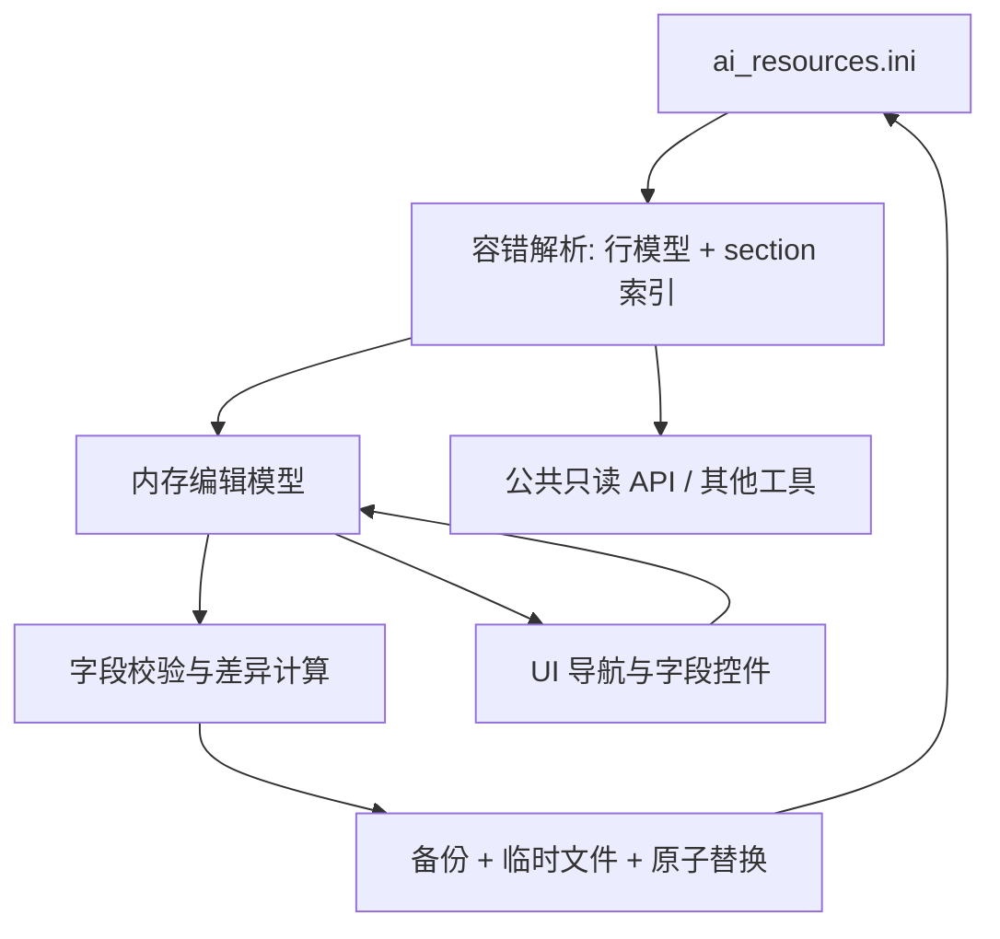

# AIhub 服务器地址设置插件开发计划

更新日期：2026-11-17
状态：设计稿（本文档不含实现代码）
目标目录：[AIhub](file:///g:/ND_openSource/NDanim_Pack/NDAnim_Tools/NDTools/AIhub)
参考实现：[resource_settings.ms](file:///g:/UGit/Phy-SIC/ground_pipeline/ImagePose_vv/plugin/resource_settings.ms)
配置文件：`C:\ProgramData\Autodesk\ApplicationPlugins\NDToolsBox\ai_resources.ini`

## 1 背景与目标

### 1.1 现状

- ImagePose 自带「服务连接」窗口（`PE_ResourceSettings`），只面向 `[vipose_sam3d_service]`，服务器列表固定写入 `[servers]`。
- `ai_resources.ini` 已实际承载多个服务的地址：`vipose_sam3d_service`、`skintokens`、`service`，以及调试段 `dev`。
- 各工具分别读取 ini，缺少统一入口；新增字段只能手改文件或改脚本。
- 现有 UI 直接写全局变量和全局函数，逻辑与 ImagePose 强耦合（连接测试依赖 `PEPoseServiceClient` 和 API v3 校验）。

### 1.2 目标

在 NDTools 中提供一个公共插件，作为所有 AI 服务地址的配置中心：

1. 读取 `ai_resources.ini` 的任意 section / key，文件或目录不存在时自动创建。
2. 内置字段结构化展示（类型、默认值、枚举、校验、所属工具），未知字段以通用键值方式展示。
3. 编辑字段值并原子保存；支持「未设置」与「空值」两种不同语义。
4. 新增 section（新服务）和新增 key，无需改代码即可生效。
5. 按服务维护多服务器列表，切换当前生效地址（写回该服务的 `base_url`）。
6. 提供通用连接测试（HTTP 可达性），不依赖 ImagePose 客户端。
7. 向其他 MaxScript 工具暴露只读访问 API，避免各工具自行解析 ini。

### 1.3 非目标

- 不做账号、密钥托管或权限体系，不保存加密凭据。
- 不修改任何 AI 服务端，不实现推理调度。
- 不取代各工具的专属业务参数界面；例如 `retarget_scheme` 的会话级临时切换仍由 ImagePose 自己负责，本插件只保证能看到、能安全编辑持久值。
- 不改变 ini 中已有字段的消费语义，不主动写入默认值覆盖现有默认逻辑。

## 2 参考实现分析与取舍

| 参考实现内容 | 处理方式 |
| --- | --- |
| `PE_EnsureResourceIni`：建目录、建空文件 | 沿用思路，封装为 `AIHubConfigStruct.Ensure` |
| `[servers] count / nameN / urlN` 列表结构 | 沿用结构，泛化为按服务分区（见 3.4） |
| `PE_ServerLabel`：从 URL 提取主机名作为默认名称 | 沿用，作为名称留空时的派生值 |
| `PE_SaveActiveServer`：同时写 `base_url` 和 `server_name` | 沿用并泛化到任意服务段 |
| `PE_GetServers` / `PE_SaveServers` 的删除尾项清理 | 沿用，补充重复地址去重和至少保留一条 |
| 下拉切换即写盘 | 改为「先改编辑区，点保存才写盘」，避免误切（见 11 待确认） |
| `PE_GetRetargetScheme` 等硬编码读取函数 | 由 schema 注册表 + 通用 `Get` 替代 |
| `global` 变量与全局函数 | 改为结构体方法，仅保留一个公共单例（遵循项目约定） |
| 连接测试依赖 `PEPoseServiceClient`、校验 api_version | 解耦为通用 HTTP 测试，只报告可达性和响应摘要 |
| `getIniSetting` / `setIniSetting` | 读取沿用；由于 MaxScript 无法枚举 section/key、无法保留注释，写入改为自研解析与重写 |

## 3 配置文件契约

### 3.1 现状快照

```ini
[servers]
count=1
name1=192.168.139.130:8010
url1=http://192.168.139.130:8010

[vipose_sam3d_service]
base_url=http://192.168.139.130:8001

[skintokens]
base_url=http://192.168.139.125:8909
[service]
base_url=http://127.0.0.1:8010
```

### 3.2 已知字段注册表

| section | key | 类型 | 默认/未设置语义 | 消费方 | 插件权限 |
| --- | --- | --- | --- | --- | --- |
| `vipose_sam3d_service` | `base_url` | url | 未设置时 ImagePose 回退 `http://127.0.0.1:8010` | ImagePose | 读写 |
| `vipose_sam3d_service` | `timeout_ms` | int | 未设置时按 `180000` | ImagePose | 读写，范围 1000–3600000 |
| `vipose_sam3d_service` | `retarget_scheme` | enum | 未设置视为 `v4` | ImagePose | 读写，`v1` / `v4` |
| `vipose_sam3d_service` | `server_name` | string | 由当前地址派生 | ImagePose | 自动维护，不手填 |
| `vipose_sam3d_service` | `target_pose_rest_rebase` | 三态 | **未设置 = 默认启用**；`0` 关闭；`1` 开启 | ImagePose | 三态编辑 |
| `vipose_sam3d_service` | `use_msdata` | bool | 未设置视为 `false`，仅调试用 | ImagePose | 读写，保存前提示 |
| `skintokens` | `base_url` | url | 未设置时由消费方决定 | SkinTokens 相关工具（具体入口待确认） | 读写 |
| `service` | `base_url` | url | 未设置时按 `http://127.0.0.1:8010` | 待确认（暂未找到明文调用方） | 读写 |
| `dev` | `allow_local` | bool | 未设置视为 `false` | ImagePose 调试 | 读写，保存前提示 |
| `servers` | `count` / `nameN` / `urlN` | 托管列表 | 空列表时由 `base_url` 初始化 | ImagePose | 由服务器面板管理，不逐条裸编辑 |

「服务段」的定义：包含 `base_url` 的 section。未注册但含 `base_url` 的 section 自动视为服务。

### 3.3 读写与兼容规则

- 读取 section / key 大小写不敏感；写回时保留文件中已有的大小写形式。
- 保留原有行顺序与注释（`;`、`#`），只改动发生变化的行；新增 key 追加到所属 section 末尾，新增 section 追加到文件末尾。
- 允许空 section（只有标题行），但新增字段时必须指定已存在或新建的 section。
- 重复 key：读取以第一个为准并标记冲突，保存时若编辑了该 key 则合并为一条并给出提示。
- 文件不存在：创建父目录与空文件，不写入任何默认值，保持各工具现有缺省逻辑。
- 编码：以现有 ANSI/GBK 为主；检测 UTF-8 BOM / UTF-16 BOM 时原样回写。值建议使用 ASCII（URL、枚举、数字）；允许中文名称，但提示跨工具读取可能乱码。
- 行尾与末尾换行保持原文件风格，避免整文件 diff。
- 空值语义：
  - 输入框为空并保存 → 写入 `key=`（键存在、值为空）。
  - 选择「恢复默认（未设置）」→ 删除该 key。
  - 两者对 `target_pose_rest_rebase` 等字段行为不同，UI 必须明确区分，不允许混用。

### 3.4 多服务与多服务器模型

- 每个服务段的当前地址就是该段的 `base_url`。
- 服务器列表分区规则：
  - `vipose_sam3d_service` 继续使用 legacy `[servers]`，与 ImagePose 双向兼容。
  - 其他服务使用 `[servers:<section>]`，内部结构同为 `count` / `nameN` / `urlN`。
  - 例：`[servers:skintokens]`、`[servers:service]`。
- 首次加载某服务且其列表为空时，用当前 `base_url` 惰性初始化一条记录并写回，不做全文件批量迁移。
- 切换当前服务器：同时更新该服务段的 `base_url` 与 `server_name`。
- 删除服务器：至少保留一条；删除当前项后自动选中相邻项，但必须点保存才落盘。
- 旧工具只读 `base_url`，因此新增 `[servers:xxx]` 段对旧版本无副作用；不使用单一 `[servers]` 作为所有服务共享列表，避免不同机器/端口互相污染。

### 3.5 新增字段的存储

- 新字段直接写入目标 section，不额外维护元数据文件。
- 类型来源优先级：内置 schema → 本次新增时选择的类型 → 按值推断（含 `://` 视为 url，纯整数视为 int，`1/0/true/false` 视为 bool，其余为 string）。
- 若希望某个自定义字段长期拥有标签、默认值、校验或健康检查路径，需要在 `AIHub_Schema.ms` 增加一条注册；这是开发者行为，不要求终端用户操作。
- 新增服务 = 新建 section + 写 `base_url`；保存后自动出现在服务列表，并参与服务器切换与连接测试。

## 4 总体设计

### 4.1 模块划分

| 文件 | 职责 |
| --- | --- |
| `AIHub_Config.ms` | `AIHubConfigStruct`：路径、Ensure、解析、模型、校验、原子保存、备份、字段与服务器读写 |
| `AIHub_Schema.ms` | 内置字段注册表：section、key、类型、标签、默认值、枚举、范围、是否只读、health 路径、消费方 |
| `AIHub_Http.ms` | `AIHubHttpStruct`：通用 HTTP 可达性测试，返回结构化结果 |
| `AIHub_UI.ms` | `AIHub_Settings` rollout：导航、编辑、服务器面板、保存/撤销、状态栏 |
| `AIHub.ms` | 入口：加载模块，创建公共单例 `AIHub`，提供 `AIHub.OpenSettings()` |

约束：按项目约定以结构体组织，不散布全局变量和全局函数；全插件仅暴露一个公共单例 `AIHub` 和一个打开窗口的入口。

### 4.2 数据流



图 1：磁盘文件是唯一事实来源；UI 只改内存模型，保存时按差异写回并重新解析。

### 4.3 生命周期

- 打开：`Ensure` → 解析 → 识别服务 → 刷新 UI；文件损坏（无法解析的行）不丢弃，原样保留并在状态栏提示。
- 编辑：只修改内存模型，窗口标题显示 `*` 表示未保存。
- 保存：全量校验 → 备份 `.bak` → 写同目录临时文件 → 原子替换 → 重新解析 → 刷新服务与字段 → 状态栏显示保存时间。
- 外部修改：打开窗口、保存前比较文件修改时间；发现被其他工具改动时提示「重新加载 / 覆盖」，不静默覆盖。
- 公共读取：每次调用都直接读文件（文件很小），避免缓存导致其他工具读到旧地址；UI 内部才持有模型。

### 4.4 公共 API 契约

```maxscript
AIHub.Get <section> <key> <default>        -- 返回字符串或 default
AIHub.GetUrl <section> <defaultUrl>        -- 去尾部 "/" 的地址
AIHub.GetInt <section> <key> <default>     -- 安全转换
AIHub.GetBool <section> <key> <default>    -- 1/true/on/yes 为真
AIHub.Services()                           -- #(section 名数组)
AIHub.TestUrl <url> timeoutMs:<5000>       -- 返回结果结构体
AIHub.OpenSettings()
```

- 写操作不对外暴露，统一走设置窗口，避免多个工具同时改写。
- `GetUrl` 的默认值仅在 key 不存在或为空时生效，语义与 ImagePose 现有读取函数保持一致。
- 其他工具接入示例：把 `PE_GetServiceBaseUrl()` 内的 `getIniSetting` 替换为 `AIHub.GetUrl "vipose_sam3d_service" "http://127.0.0.1:8010"`；旧代码可继续工作，不强制迁移。

## 5 界面设计

### 5.1 布局

```text
+----------------------------------------------------------------------+
| 配置文件: C:\ProgramData\...\ai_resources.ini   [重新加载] [打开目录]  |
+----------------------------------------------------------------------+
| 服务 / 段          | 字段列表（键、类型、值、来源）                   |
| > vipose_sam3d...  |  base_url      url    http://...      内置      |
|   skintokens       |  timeout_ms    int    180000          内置      |
|   service          |  retarget_scheme enum v4              内置      |
|   dev              |  api_key       string ******          自定义    |
|                    |                                                  |
| [新增服务] [删除服务]                                                  |
+----------------------------------------------------------------------+
| 编辑: 键 [base_url]  值 [____________________]  未设置 [ ]  [应用]     |
+----------------------------------------------------------------------+
| 服务器: [下拉]  [新增当前地址] [删除]                                  |
| 地址: [______________________] 超时(ms): [_____]  [连接测试]           |
+----------------------------------------------------------------------+
| [保存] [撤销更改]               状态: 未修改 / 已保存 / 错误信息        |
+----------------------------------------------------------------------+
```

### 5.2 控件与交互

- 左侧：section 列表，显示字段数与是否为服务；翻页后保持滚动位置。
- 右侧：字段列表；内置字段显示中文标签，自定义字段标记「自定义」；只读字段（`server_name`）灰显。
- 编辑区按类型切换控件：
  - url / string：`editText`
  - int：`editText` + 数值校验（可选 `spinner`）
  - bool：`checkBox`
  - enum：`dropdownList`
  - 三态（`target_pose_rest_rebase`）：`dropdownList`（默认未设置 / 开启 / 关闭）
  - 可选字段统一提供「未设置（删除该键）」选项
- 「新增字段」对话框：section（现有或新名称）、key、类型、值、是否立即写盘（默认只进内存）。
- 「新增服务」对话框：section 名、`base_url`、显示名称（可选）。
- 删除内置必需字段或内置服务时禁止并说明原因；删除自定义字段需二次确认。
- 未保存时切换 section 不丢编辑（保留内存修改），关闭窗口时提示保存/放弃。

### 5.3 校验与错误定位

| 校验项 | 规则 | 失败处理 |
| --- | --- | --- |
| URL | 必须以 `http://` 或 `https://` 开头，无空格，host 非空；保存前去尾部 `/` | 阻止保存并定位字段 |
| 端口 | 1–65535（若显式填写） | 阻止保存 |
| 整数 | 可转 int，`timeout_ms` 1000–3600000 | 阻止保存 |
| 布尔 | `1/0/true/false/on/off/yes/no`，统一写 `1/0` | 规范化后保存 |
| 枚举 | 仅允许注册表列出的值 | 阻止保存 |
| key / section 名 | 非空，不含 `[]=;#` 与首尾空白 | 阻止保存 |
| 重复 key | 同一 section 内不允许 | 阻止保存或提示合并 |

保存失败时文件保持原状，备份不删除；状态栏与字段旁同时显示原因。

### 5.4 兼容与风格

- 纯 MaxScript rollout，兼容 3ds Max 2015 及以上，不引入 WPF；固定尺寸，沿用 NDTools 现有中文标签风格。
- 字段较多时使用 `listBox` 虚拟显示，避免一次创建大量控件。
- 备选方案：后续可把字段列表换成 `dotNetControl` 的 `DataGridView`，需先在 2015 上验证高 DPI 与主题兼容性，暂不纳入首期。

## 6 连接测试设计

- 通用 HTTP GET：仅接受 `http` / `https`；默认超时 3000 ms，可在界面选择 3000 / 5000 / 10000。
- 健康检查路径：
  - `vipose_sam3d_service`：`/v2/pose/health`（仅用于测试请求，不在公共插件内校验业务 XML 或 API 版本）
  - `skintokens`、`service`：`/health`（待与服务方确认）
  - 未注册服务：`/`；可在字段注册表中增加 `health_path` 扩展
- 结果结构：是否可达、HTTP 状态码、耗时、响应体前 200 字符、异常类型。
- 结果分类：DNS/连接失败、超时、4xx/5xx、200 但内容异常、成功。
- 只做可达性判断，不做鉴权、不发送凭据、不解析业务协议；vipose 的 v2 XML 契约仍由 ImagePose 自带的客户端负责。
- MaxScript 同步执行会阻塞 UI，测试期间禁用按钮并显示「测试中」；超时上限 10 秒。

## 7 错误处理、安全与并发

- 写入：同目录临时文件 + `File.Replace`（目标存在时）或 `Move`（首次创建）；替换失败回退直接写入并保留备份。
- 备份：每次保存前生成 `ai_resources.ini.bak`，最多保留 3 份轮转；备份失败则中止保存。
- 权限：ProgramData 目录可能只读；捕获「拒绝访问」并提示以管理员身份运行 Max 或手动修改权限，不弹出未处理异常。
- 编码：解析时记录 BOM 与编码，回写保持一致；新增中文值前提示兼容风险。
- 明文风险：ini 位于 ProgramData，任何本机用户可读；如果用户新增 `api_key` 一类字段，界面提示「明文存储」。
- 并发：保存前比较修改时间，外部变更时要求用户确认；不实现文件锁，不静默覆盖。
- 日志：只在 MaxScript Listener 输出必要诊断，不打印完整 token 类值。

## 8 部署与集成

- 源码目录：`NDAnim_Tools\NDTools\AIhub\`（即本目录）。
- 运行时目录：`<3ds Max 根目录>\scripts\NDTools\AIhub\`，由 NDTools.zip 统一分发。
- 入口二选一，推荐在 [NDTools.ms](file:///g:/ND_openSource/NDanim_Pack/NDAnim_Tools/Startup/NDTools.ms) 中增加 macroScript，保持现有工具入口一致：

```maxscript
macroScript AIHubSettings category:"NDTools" tooltip:"AI 服务器设置" buttonText:"AI服务器设置"
(
    fileIn ((getdir #maxroot) + "scripts\\NDTools\\AIhub\\AIHub.ms")
)
```

- `AIHub.ms` 自身负责重复加载保护：已存在单例时只打开窗口，不重复定义结构体。
- 不要求管理员权限；ini 父目录不存在时自动创建。
- 可选集成：ImagePose 的「服务连接」按钮改为调用 `AIHub.OpenSettings()`，旧窗口保留一个版本作为回退；此项不纳入首期，避免同时影响 ImagePose 发布。

## 9 验收用例

| 场景 | 预期结果 |
| --- | --- |
| ini 不存在 / 父目录不存在 | 自动创建空文件，界面可正常打开，不写入默认值 |
| 现有 ini（含 4 个 section） | 全部字段与服务器正确展示，未识别字段也可见 |
| 编辑 `base_url` 保存 | 仅该行变化；ImagePose 重新读取得到新地址 |
| 切换服务器 | `base_url` 与 `server_name` 同步更新；未点保存不落盘 |
| 新增自定义 key | 文件新增一行；重新打开仍在；类型按值推断 |
| 新增服务 section | 自动出现在服务列表，可切换服务器、可测试 |
| 删除自定义字段 / 自定义服务 | 二次确认后删除；内置必需项禁止删除 |
| `target_pose_rest_rebase` 三态 | 未设置 / 1 / 0 分别正确写入与读回 |
| 非法 URL、超范围超时、重复 key | 阻止保存并定位字段，文件不变 |
| 文件被外部修改 | 保存前提示重新加载或覆盖，不静默覆盖 |
| 文件只读 / 无权限 | 明确错误提示，原文件不变 |
| ANSI / UTF-8 BOM / UTF-16 文件 | 读回一致，保存后编码不漂移 |
| 连接测试成功 / 超时 / 404 / 不可达 | 分别显示状态码、耗时与摘要，UI 可恢复 |
| ImagePose 旧 UI 与新插件交叉使用 | `[servers]` 与 `base_url` 双向兼容，无字段丢失 |
| 旧版 NDTools 读取新文件 | 新增 `[servers:xxx]` 与自定义字段被忽略，不影响旧工具 |

## 10 实施阶段

| 阶段 | 内容 | 完成条件 |
| --- | --- | --- |
| P1 配置内核 | 解析器、行模型、字段模型、原子写入、备份、公共读取 API | 现有 ini 往返无损；异常输入不损坏文件 |
| P2 只读界面 | 服务导航、字段列表、类型渲染、状态栏 | 可完整浏览全部现有字段，保存按钮不可用 |
| P3 编辑与服务器 | 字段编辑、校验、服务器列表、切换当前地址 | 保存后其他工具可读到新值；切换语义正确 |
| P4 增删与迁移 | 新增/删除字段与服务、`[servers:xxx]` 惰性迁移、外部变更检测 | 全部验收用例通过 |
| P5 集成与回归 | NDTools 入口、分发路径、ImagePose 兼容回归 | 打包后从工具栏可打开；ImagePose 功能不退化 |

本计划不含实现代码与测试资产；中间验证脚本、备份与调试输出放在工作目录或系统临时目录之外。

## 11 待确认

1. 界面形态：按本方案做「内置字段结构化 + 未知字段通用键值」的混合编辑器，还是只要一个纯键值表？
2. 服务器列表是否采用「vipose 沿用 `[servers]`，其他服务用 `[servers:<section>]`」的分区方案？
3. 切换服务器是否必须点保存才生效（本方案推荐），还是像 ImagePose 一样切换即写盘？
4. `skintokens`、`service` 两类服务的健康检查路径与真实消费方分别是什么？是否首期就提供连接测试？
5. 入口放在 `Startup\NDTools.ms` 的 macroScript，还是由 `AIHub.ms` 自行注册？
6. 是否允许删除内置 section / 内置字段；若允许，需要哪些二次确认？
7. 字段值是否需要支持中文（如服务器显示名），还是统一要求 ASCII 以兼容现有 INI 读取方式？
8. 是否在下一版把 ImagePose 的「服务连接」窗口统一到本插件。
